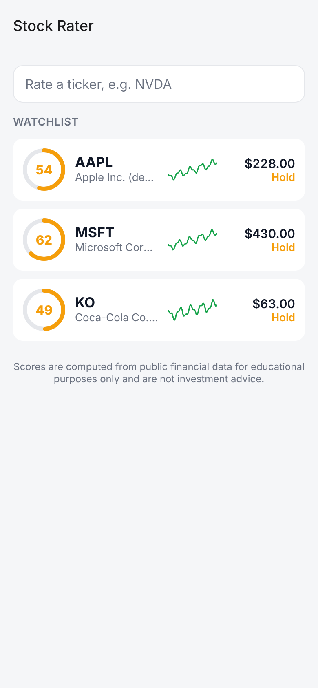
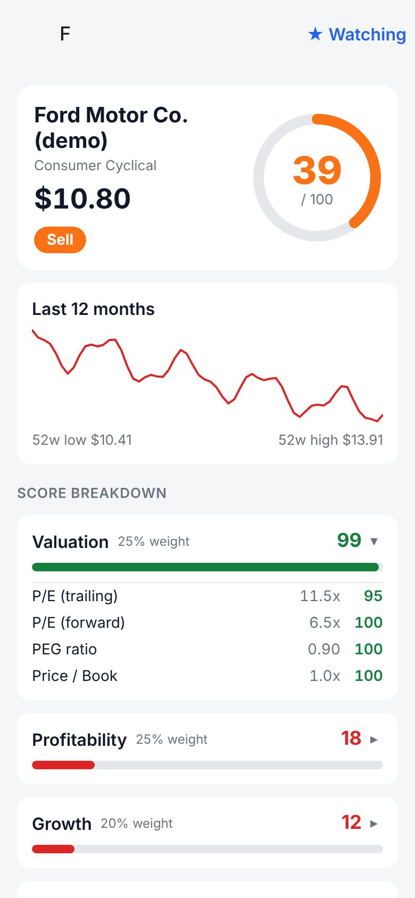

# Stock Rater

A mobile app that rates stocks from 0–100 and gives each one a label
(**Strong Buy / Buy / Hold / Sell / Strong Sell**) based on its fundamentals
and price momentum.

| Watchlist | Rating detail |
| --- | --- |
|  |  |

> Educational project. Scores are a simple rules-based model, not investment advice.

## How it's built

```
mobile/   Expo (React Native + TypeScript) app, using Expo Router
backend/  Python FastAPI service: fetches data with yfinance and computes the score
```

The phone calls the backend. The backend pulls data from Yahoo Finance via
[yfinance](https://github.com/ranaroussi/yfinance), which needs no API key.
yfinance is a Python library, so it runs on a server rather than on the phone.

## How the score works

Each metric maps linearly from a "bad" value (0 points) to a "good" value
(100 points), clamped at both ends. A category's score is the average of its
metrics, and the overall score is the weighted average of the categories.

| Category (weight) | Metrics (bad → good) |
| --- | --- |
| Valuation (25%) | P/E trailing 40→10, P/E forward 35→10, PEG 3→1, Price/Book 8→1. A negative P/E (the company is losing money) scores 0. |
| Profitability (25%) | ROE 0→25%, net margin 0→25%, operating margin 0→30% |
| Growth (20%) | Revenue growth −5%→20%, earnings growth −10%→25% |
| Financial health (15%) | Debt/Equity 2.0x→0.3x, current ratio 0.8→2.0, FCF yield 0→6% |
| Momentum (15%) | 1-year return −20%→30%, price vs 200-day average −10%→+10%, vs 50-day −5%→+5% |

The overall score is a whole number, and the label comes from it: ≥80 Strong
Buy, ≥65 Buy, ≥45 Hold, ≥30 Sell, below that Strong Sell.

If a metric is missing, the model skips it instead of counting it as 0. The
API returns a `coverage` value so the app can show how much data a score is
based on. If fewer than 40% of the metrics are available, the stock is
**Not rated** instead of getting a label based on a handful of numbers. This
happens with ETFs and funds, which have price data but no company financials.

Analyst consensus and price targets are shown for comparison but are
**not** part of the score. All thresholds and weights are in
[`backend/app/scoring.py`](backend/app/scoring.py).

## Running it

### 1. Backend

```bash
cd backend
python3 -m venv .venv && source .venv/bin/activate   # Python 3.11+
pip install -r requirements-dev.txt
uvicorn app.main:app --reload --host 0.0.0.0 --port 8000
```

For offline demo data (AAPL, MSFT, KO, F, XYZQ and the fund QQQ), start it
with `DATA_SOURCE=sample`. The demo numbers are illustrative, not real market data.

Run the tests with `pytest`.

API:
- `GET /api/rating/{ticker}`: full rating with category and metric breakdown
- `GET /api/ratings?tickers=AAPL,MSFT`: batch endpoint used by the watchlist
  (up to 25 tickers, fetched in parallel; unknown or failing tickers are skipped)
- `GET /health`

Results are cached in memory for 15 minutes per ticker.

If Yahoo rate-limits the server, the API returns a 502 error with a message
saying so, and the app shows it.

### 2. Mobile app

```bash
cd mobile
npm install
npx expo start
```

Open it with Expo Go on your phone, or in an iOS or Android simulator. Press
`w` to open it in a browser. By default the app looks for the backend on port
8000 of the computer running Expo, so your phone and computer need to be on
the same Wi-Fi network. To point the app at a different server:

```bash
EXPO_PUBLIC_API_URL=https://your-server.example.com npx expo start
```

Checks: `npm run typecheck` and `npm run lint`

Before publishing to the app stores, host the backend on HTTPS. iOS and
Android release builds block plain `http://` requests (Expo Go allows them
during development).

## Ideas for next steps

- Sector-relative scoring (a P/E of 30 means different things for software and for utilities)
- Ticker search and autocomplete
- Dark mode
- Score history and price alerts
- Deploy the backend (Fly.io, Render, Railway) and build the app with EAS
